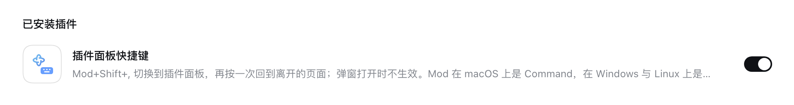

# dsh-plugin-panel-toggle

[简体中文](README.zh.md)

Adds an in-app shortcut (`Mod+Shift+,`, or `⌘⇧,` on macOS) to jump to the **Plugins** panel
and press again to return to the page you left.
Rebind or clear it anytime in **Settings → Shortcuts** (`Mod` is Command on macOS and Control on Windows/Linux;
open dialogs keep the key).

Requires DeepSeek Harness `0.2.2-rc.3` or newer
with the built-in **Plugins** panel (browser tabs may reserve the key first).
Enable **Plugins panel shortcut** in **Plugin Modular Improvement Plan**, or run `pnpm install` in this directory
and select it in **Plugins → Add plugin** (or via `install_bundle`).

## Screenshots

The **Plugins** panel opened by the shortcut from the Automation page (Chinese UI).

[Main view in dark mode](docs/assets/screenshots/main-dark.png)

[Project documentation](docs/README.md)
