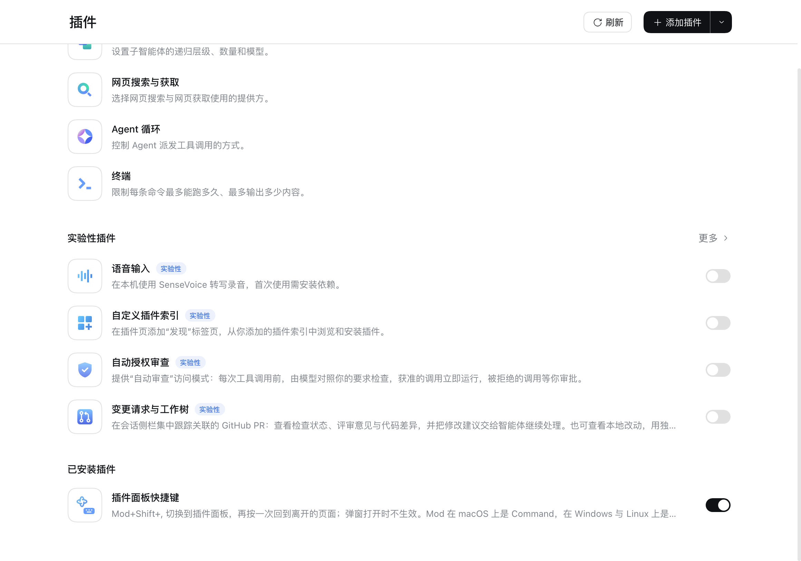

# dsh-plugin-panel-toggle

给 DeepSeek Harness 增加一个应用内快捷键：切到 **插件** 面板，再按一次回到原来的页面。

| 输入 | 安装前 | 安装后 |
| --- | --- | --- |
| 在会话页按 Mod+Shift+, | 无反应 | 打开插件面板 |
| 在其他面板按 Mod+Shift+, | 无反应 | 打开插件面板 |
| 再按一次 Mod+Shift+, | 无反应 | 回到原来所在的面板或会话页 |
| 弹窗打开时按 Mod+Shift+, | 无反应 | 无反应（按键仍归弹窗） |

`Mod` 在 macOS 上是 Command，在 Windows 和 Linux 上是 Ctrl。
默认 macOS 为 `⌘⇧,`，其他平台为 `Ctrl+Shift+,`；可在 **设置** > **快捷键** 中改键。

## 依赖

- DeepSeek Harness 0.2.2-rc.3 或更新版本，且内置「插件」面板可用（随 Web 应用 bundle 提供）。
- Desktop 窗口与浏览器页面都可用；浏览器标签页自身占用的组合键仍可能先被浏览器拿走。

## 安装

在源码检出目录运行 `npm ci` 安装开发依赖并构建插件。
把本目录作为本地 bundle 安装：**插件** > **添加插件**，或让智能体对本目录执行 `install_bundle`。
安装后 **插件** 列表里显示为 **Plugins panel shortcut** / **插件面板快捷键**。

## 使用

- 在应用任意位置按 Mod+Shift+,（输入框、终端里也可以）。
- 第一次按下打开插件面板，并保留它原来的标签页与详情位置。
- 再按一次回到第一次按下时所在的面板。
  用侧栏或别的插件打开插件面板后按快捷键，同样回到离开的页面。
- 该命令列在 **设置** > **快捷键** 里，可像其他命令一样改键或清除。

## 实拍截图

从「自动化任务」按下快捷键后打开的「插件」面板。

[深色模式主图](docs/assets/screenshots/main-dark.png)

## 限制

- 弹窗打开时按键交给弹窗处理：在弹窗遮挡下切换背后页面，用户看不到按下快捷键的结果，所以先按 Esc 关闭弹窗。
- 没有内置插件面板的 profile（例如禁用了插件管理器的自定义 profile）没有可选的目标面板；
  此时快捷键不改动当前页面，并只记录一次警告，不会报错。
- 「返回」只记一层：快捷键记住最后一个不是插件面板的面板，不是完整导航历史。
- 长按产生的重复按键会被快捷键层消费但不会连续切换，每次切换需要重新按一次。

## 卸载

在 **插件** 里禁用本 bundle 即可：命令与面板订阅一并移除；在设置里改过的键位会作为覆盖项保留，重新安装后仍然可用。
